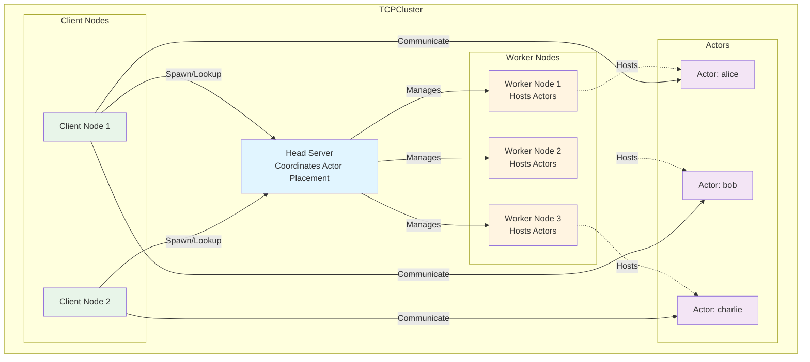

# Actor Model Overview

The Actor model is a concurrency programming model designed to simplify the handling of concurrent tasks.

In this model, an *actor* is the basic unit of concurrency with the following characteristics:

- Each actor has its own independent execution thread.
- Each actor has its own member variables.
- These variables can only be accessed and modified by the actor's own thread.
- An actor includes a special kind of member function called *receivers*. When a receiver is called, the call will be added to a queue and executed in order on the actor's thread.
- Once there are no references pointing to the actor and all receivers have been executed, the actor can be reclaimed by the system.

> **Note:**
> The third characteristic of the Actor model has not yet been enforced by the language, so the member variables of an *actor* do not yet provide full concurrency safety. In the future, a new type system may address this issue, ensuring the concurrency safety of member variables.

The Actor model is primarily used for concurrent access and modification of the same object in multi-threaded environments. For example, a bank account object may be accessed simultaneously by multiple threads for operations like deposits or withdrawals, potentially leading to data races without proper synchronization.

```cangjie
public class Account {
    public Account(
        private let name: String,
        private var balance: Float64
    ) {}

    public func deposit(amount: Float64): Unit {
        balance += amount
    }

    public func withdraw(amount: Float64): Unit {
        if (balance < amount) {
            throw BalanceNotEnoughException(name)
        }
        balance -= amount
    }

    public func getBalance(): Float64 {
        balance
    }
}
```

Simultaneous access and modification of the object in a multi-threaded environment can lead to data races:

```cangjie
let account = Account("Steven", 0.0)
spawn {
    account.deposit(1000.0)
}
spawn {
    account.withdraw(2000.0)
}
```

Correctly using the Actor model can make concurrent programming simpler and more efficient.


# Local Actors

Using the bank account example above, to avoid thread safety issues, we can design an *actor* specifically for handling account operations using the Actor model.

First, we can annotate the `Account` class with the [@Actor](./api/macros/macros_package_api/macros_package_macros.md#actor-macro) macro to mark it as an actor. Then, we use the [@Receiver](./api/macros/macros_package_api/macros_package_macros.md#receiver-macro) macro to mark the `deposit`, `withdraw`, and `getBalance` functions:


```cangjie
@Actor
public class Account {
    public Account(
        private let name: String,
        private var balance: Float64
    ) {}

    @Receiver
    public func deposit(amount: Float64): Unit {
        balance += amount
    }

    @Receiver
    public func withdraw(amount: Float64): Unit {
        if (balance < amount) {
            throw BalanceNotEnoughException(name)
        }
        balance -= amount
    }

    @Receiver
    public func getBalance(): Float64 {
        balance
    }
}
```

For the rules and limitations of the [@Actor](./api/macros/macros_package_api/macros_package_macros.md#actor-macro) and [@Receiver](./api/macros/macros_package_api/macros_package_macros.md#receiver-macro) macros, please refer to the corresponding documentation.

We can create an instance of the `Account` class by calling its constructor, for example:

```cangjie
let stevenAccount: Account = Account("Steven", 0.0)
```

When creating an `Account` instance, the system will also automatically create an associated execution thread for that instance.

## Receivers

Unlike regular functions, the invocation of a receiver is asynchronous and it returns an [ActorFuture\<T>](./api/actors_package_api/actors_package_classes.md#class-actorfuture) object. This object allows you to wait for the completion of the receiver and obtain the result, where `T` is the return type of the receiver. For example, calling `getBalance` will return an [ActorFuture\<Float64>](./api/actors_package_api/actors_package_classes.md#class-actorfuture) object:

```cangjie
let fut: ActorFuture<Float64> = stevenAccount.getBalance()
```

When a receiver is called, the call is added to a queue and executed sequentially on the actor's dedicated thread.

Subsequently, we can block the current Cangjie thread by calling the `get` function of the [ActorFuture\<T>](./api/actors_package_api/actors_package_classes.md#class-actorfuture) object, which will wait until the `steven.getBalance()` receiver completes and returns a value of type `T`.

```cangjie
let stevenBalance: Float64 = fut.get()
```

The value of `stevenBalance` will depend on the value of the `balance` member variable at the time `steven.getBalance()` is executed.

In a multi-threaded environment, although receivers may be called concurrently, they are executed sequentially within the same actor instance, preventing any interleaved execution. Therefore, we can think of them as atomic functions of this actor, which helps avoid data races.

```cangjie
let account = Account("Steven", 0.0)
spawn {
    account.deposit(1000.0)
}
spawn {
    account.withdraw(2000.0)
}
```

> **Note:**
> Currently, the member variables of an actor do not provide full concurrency safety. For example, in the following case, the public member variables can still be accessed and modified directly from outside:
> ```cangjie
> @Actor
> public class MyActor {
>     public var x: Int64 = 0
> }
>
> let myActor = MyActor()
> spawn {
>     myActor.x = 2
> }
> spawn {
>     myActor.x = 3
> }
> ```
>
> In the future, a new type system could address this issue, ensuring the concurrency safety of member variables.

## Execution Order of Receivers

When calling two receivers on the same actor within the same thread, these receivers will be executed in the order they were called. For example:

```cangjie
func foo() {
    let account = Account("Federico", 0.0)
    account.deposit(1000.0)
    account.withdraw(500.0)
    let fut = account.getBalance()
    println(fut.get())
}
```

In the absence of other threads, this code will always output the following, ensuring that `account.withdraw(500.0)` will not execute before `account.deposit(1000.0)`:

```text
500.0
```

However, when different threads call receivers of the same actor, the execution order is not guaranteed. For example:

```cangjie
let account = Account("Steven", 0.0)
spawn {
    account.deposit(1000.0)
}
spawn {
    account.withdraw(500.0)
}
```

The following execution orders are possible:

```text
account.deposit(1000.0)
account.withdraw(500.0)
```

```text
account.withdraw(500.0)
account.deposit(1000.0)
```

## Exceptions Thrown by Receivers

Any uncaught exceptions or errors thrown by a receiver will propagate to the corresponding [ActorFuture\<T>](./api/actors_package_api/actors_package_classes.md#class-actorfuture) object, similar to how `spawn` handles them.

Continuing with the `Account` example, if the `balance` in the `withdraw(amount)` function is insufficient, it will throw a `BalanceNotEnoughException`:

```cangjie
@Receiver
public func withdraw(amount: Float64): Unit {
    if (balance < amount) {
        throw BalanceNotEnoughException(name)
    }
    balance -= amount
}
```

The thrown exception will be passed to the corresponding [ActorFuture](./api/actors_package_api/actors_package_classes.md#class-actorfuture) object, and when its `get` function is called, the same exception will be thrown. That is in the following example:

```cangjie
let account = Account("Hamid", 0.0)
let fut: ActorFuture<Unit> = account.withdraw(500.0)
try {
    let res = fut.get() // throws BalanceNotEnoughException
} catch (e: BalanceNotEnoughException) {
    println("fut.get() throws BalanceNotEnoughException")
    println()
    e.printStackTrace()
}
```

Since `account.withdraw(500.0)` threw a `BalanceNotEnoughException`, calling `fut.get()` will also throw the same exception. The output will be as follows:

```text
fut.get() throws BalanceNotEnoughException

An exception has occurred:
Exception: Balance for account Hamid is not enough.
         at default.BalanceNotEnoughException::init(std.core::String)(/home/.../main.cj:6)
         at default.Account::withdraw::lambda.0()(/home/.../main.cj:25)
         at actors.ActorFuture<...>::execute()(stdx/actors/actor_future.cj:90)
         at actors.SequentialDispatcher::startActorLoop::lambda.0()(stdx/actors/actors.cj:46)
```

When a receiver throws an exception, the actor's dedicated thread will proceed to execute the next receiver call in the queue:

```cangjie
let account = Account("Hamid", 0.0)

let fut: ActorFuture<Unit> = account.withdraw(500.0)
let fut2: ActorFuture<Float64> = account.getBalance()

try {
    let res = fut.get()
} catch (e: BalanceNotEnoughException) {
    println("fut.get() throws BalanceNotEnoughException")
    println()
    e.printStackTrace()
    println()
}

let res = fut2.get() // account.getBalance() will still be executed
println("Balance = ${res}")
```

After `account.withdraw(500.0)` is executed and throws an exception within the actor's thread, the thread will continue to execute `account.getBalance()`. The output will be as follows:

```text
fut.get() throws BalanceNotEnoughException

An exception has occurred:
Exception: Balance for account Hamid is not enough.
         at default.BalanceNotEnoughException::init(std.core::String)(/home/.../main.cj:6)
         at default.Account::withdraw::lambda.0()(/home/.../main.cj:25)
         at actors.ActorFuture<...>::execute()(stdx/actors/actor_future.cj:90)
         at actors.SequentialDispatcher::startActorLoop::lambda.0()(stdx/actors/actors.cj:46)

Balance = 0.0
```

Later we will add a feature to allow developers to have control over the behaviour of handling excceptions and errors, for example, to stop or to restart an actor.

## Lifecycle of an actor

An actor can be garbage collected when there are no references pointing to it, and there are no pending receiver calls to be executed:

```cangjie
func test(): Unit {
    let account = Account("Ziming", 0.0)
    let fut = account.deposit(5.0)
    println(fut.get())
}

func bar() {
    test()
    // account could be reclaimed
}
```

After the `test()` function returns, since there are no remaining references to the account and no pending receivers (because we awaited the result of `account.deposit(5.0)` inside `test()`), the actor referenced by account and its dedicated execution thread will be reclaimed by the system.


## Priority between Receivers

Users can specify priority for receivers, allowing higher-priority receivers to be executed before lower-priority ones.

First, users need to enable receiver priority by adding the `[enableReceiverPriority: true]` annotation to the class. For example:

```cangjie
@Actor[enableReceiverPriority: true]
public class Account {
    public Account(
        private let name: String,
        private var balance: Float64
    ) {}
}
```

If `enableReceiverPriority` is set to `false` or if the `@Actor` macro does not include this option, it means that receiver priorities are not enabled.

Next, we can assign a default priority level to each receiver. Currently, we provide 10 priority levels, represented by integers from 1 to 10. The higher the number, the higher the priority. If the priority option is not set, the default value is 5:

```cangjie
@Actor[enableReceiverPriority: true]
public class Account {
    ...

    @Receiver[priority: 10]
    public func deposit(amount: Float64): Unit {
        balance += amount
    }

    @Receiver[priority: 1]
    public func withdraw(amount: Float64): Unit {
        if (balance < amount) {
            throw BalanceNotEnoughException(name)
        }
        balance -= amount
    }

    @Receiver
    public func getBalance(): Float64 {
        balance
    }
}
```

By increasing the priority of `deposit` and lowering the priority of `withdraw`, when there are many `deposit` and `withdraw` calls simultaneously, `deposit` will be prioritized, reducing the chances of `withdraw` throwing a `BalanceNotEnoughException`.

Additionally, when calling a receiver, one can override its priority by passing an extra named parameter, *config*, at the end of the argument list:

```cangjie
func foo(account: Account) {
    account.getBalance()
    account.withdraw(100.0, config: ReceiverConfig(priority: 10))
}
```

The call to `account.withdraw(100.0, config: ReceiverConfig(priority: 10))` may be executed before `account.getBalance()`.

## Deadlock

Finally, please note that calling `fut.get()` within an actor's receiver may result in a deadlock. For example:

```cangjie
@Actor
class MyActor {
    @Receiver
    func foo(): Int64 {
        let fut = this.bar()
        // this will deadlock
        fut.get()
    }

    @Receiver
    func bar(): Int64 {
        42
    }
}
```

Calling `this.bar()` will add the receiver to the end of the queue. However, blocking within a receiver causes the actor's thread to block, so `bar()` will never be executed. As a result, calling `fut.get()` inside `foo()` will block indefinitely.

## Calling Receivers in Tell mode

As discussed previously, receivers return an [ActorFuture](./api/actors_package_api/actors_package_classes.md#class-actorfuture) that allows the caller to wait for the receiver call to return and to obtain the returned value. We say that these calls are in "Ask" mode, given that the caller expects the actor to reply in the form of a completed [ActorFuture](./api/actors_package_api/actors_package_classes.md#class-actorfuture).

However, in some scenarios, the caller may not need to synchronize with the actor nor need the result of the receiver. In this context, one might want to avoid the overhead introduced by creating an [ActorFuture](./api/actors_package_api/actors_package_classes.md#class-actorfuture), and call the receiver in "Tell" mode. Calling a receiver in "Tell" mode does not create any [ActorFuture](./api/actors_package_api/actors_package_classes.md#class-actorfuture), returns `Unit`, and requires an additional parameter named `tell` that only accepts the value `Tell.True`:

```cangjie
func foo(account: Account) {
    let _: Unit = account.withdraw(100.0, config: ReceiverConfig(priority: 10), tell: True)
}
```

It is also possible for users to restrict the ways in which a receiver can be called by providing the `mode` option
to the `@Receiver` macro:

```cangjie
@Actor
public class Account {
    ...

    @Receiver[mode: TellOnly]
    public func deposit(amount: Float64): Unit {
        balance += amount
    }

    @Receiver[mode: AskAndTell]
    public func withdraw(amount: Float64): Unit {
        if (balance < amount) {
            throw BalanceNotEnoughException(name)
        }
        balance -= amount
    }

    @Receiver[mode: AskOnly]
    public func getBalance(): Float64 {
        balance
    }
}
```

In the above example,

- The function `getBalance` can only be called in "Ask" mode.
- The function `deposit(Float64)` can only be called in "Tell" mode.
- The function `withdraw(Float64)` can be called both in "Ask" and "Tell" modes.

Note that the sequential guarantees that apply to receiver calls in "Ask" mode also apply to receiver calls in "Tell" mode.

## Complete example

<!-- compile -->

```cangjie
import std.collection.ArrayList

import actors.*
import actors.macros.*

@Actor[enableReceiverPriority: true]
public class Account {
    public Account(
        private let name: String,
        private var balance: Float64
    ) {}

    @Receiver[priority: 10]
    public func deposit(amount: Float64): Unit {
        balance += amount
    }

    @Receiver[priority: 1]
    public func withdraw(amount: Float64): Unit {
        if (balance < amount) {
            throw BalanceNotEnoughException(name)
        }
        balance -= amount
    }

    @Receiver
    public func getBalance(): Float64 {
        balance
    }
}

public class BalanceNotEnoughException <: Exception {
    public init(name: String) {
        super("Balance for account ${name} is not enough.")
    }
}

main() {
    let account = Account("Steven", 0.0)
    let futs = ArrayList<Future<Unit>>()
    for (_ in 0..100) {
        let fut1 = spawn {
            for (_ in 0..10) {
                account.deposit(1000.0)
            }
        }
        let fut2 = spawn {
            for (_ in 0..10) {
                account.withdraw(1000.0)
            }
        }
        futs.add(fut1)
        futs.add(fut2)
    }
    for (f in futs) {
        f.get()
    }
    println("Balance: ${account.getBalance().get()}")
}
```


# Distributed Actors

The actor model can be extended to work across multiple nodes (processes, machines, etc.) in a distributed system. In Cangjie, distributed actors allow you to create actors that can communicate with each other even when they're running on different nodes in a network.

## Actor Interfaces

To create distributed actors, you first need to define an *actor interface* using the [@ActorInterface](./api/macros/macros_package_api/macros_package_macros.md#actorinterface-macro) macro. This interface defines the contract that distributed actors must implement.

```cangjie
@ActorInterface[distributed: true]
public interface BankAccount {
    @Receiver
    func deposit(amount: Float64): Bool

    @Receiver
    func withdraw(amount: Float64): Bool

    @Receiver
    func getBalance(): Float64
}
```

The `distributed: true` option indicates that this is a distributed actor interface, which means it can be used for remote communication across the network.

## Implementing Distributed Actors

Once you have an actor interface, you can implement it using the [@Actor](./api/macros/macros_package_api/macros_package_macros.md#actor-macro) macro:

```cangjie
@Actor
public class BankAccountImpl <: BankAccount {
    private let name: String
    private var balance: Float64

    public init(name: String, balance: Float64) {
        this.name = name
        this.balance = balance
    }

    @Receiver
    public func deposit(amount: Float64): Bool {
        balance += amount
        true
    }

    @Receiver
    public func withdraw(amount: Float64): Bool {
        if (balance < amount) {
            return false
        }
        balance -= amount
        true
    }

    @Receiver
    public func getBalance(): Float64 {
        balance
    }
}
```

## ActorHost

To manage distributed actors, you need an actor host and client. The actor host can be used to export an actor, and users can obtain proxies through actor client:

```cangjie
// Create an actor host (implementation depends on your distributed setup)
let actorHost: ActorHost

// Create and export the actor
let bankAccount = BankAccountImpl("alice", 1000.0)
match (actorHost.export("alice", bankAccount)) {
    case Some(proxy) =>
        println("Bank account exported successfully")
        // The proxy can be used directly if needed
    case None =>
        println("Failed to export bank account: name already taken")
        return
}
```

The `export` function exports a distributed actor with a *name*. This name should be unique among the exported actors of this particular actor host. Exporting twice with the same name returns `None`. On successful export, it returns `Some(ActorProxy)` which can be used directly for local communication.

Once an actor has been exported, it can be found by a corresponding actor client.

## Actor Client and Remote Actor Communication

```cangjie
// Create an actor client for remote communication
let actorClient: ActorClient
```

To obtain a proxy to an exported distributed actor, you can use the `getActor()` method of the actor client:

```cangjie
// Create a proxy to communicate with the remote actor
match (actorClient.getActor("alice")) {
    case Some(bankProxy) =>
        // Use the proxy
    case None =>
        println("Actor not found")
}
```

The `getActor()` method will return `None` if the actor is not found, and will throw `RemoteException` if the connection to the client has failed.

Alternatively, you can create an `ActorProxy` directly with the actor name and host info:

```cangjie
// Create a proxy to communicate with the remote actor
let bankProxy = ActorProxy("alice", tcpClient.getHostInfo())
```

However this does not check if the actor exists or not.

Once we obtain an actor proxy, we can use the `ask` or `tell` function to make a remote call to a particular receiver:

```cangjie
// Call remote methods - these return DistributedFuture objects
let depositFut: DistributedFuture = bankProxy.ask("deposit", [
    500.0.serialize()
])
```

The function `ask` has the following signature:

```cangjie
public func ask(receiverName: String, args: Array<DataModel>, config!: ReceiverConfig = ReceiverConfig.default): DistributedFuture
```

If the actor has been unexported from the host (using the `unexport` function) before, this function throws an `ActorNotFoundException`.

The `receiverName` corresponds to the name of the receiver declared in the actor interface. Note that this means function overloading is not allowed in actor interface declaration and a macro error will be thrown if violated. If there is no matching receiver found, this function throws a `ReceiverNotFoundException`.

The `args` is an array of `DataModel` which is the serialized arguments to that particular receiver. If the supplied arguments are invalid, e.g. the numbers do not match or the types do not match, this function throws an `IllegalArgumentException`.

This function also throws `RemoteException` when the remote connection fails and `ActorSystemException` for any potential errors coming from the specific actor system.

The `tell` function works similarly except that it does not return a `DistributedFuture`.

The execution order of remote receivers is the same as local receivers where calling two (remote) receivers on the same actor from the same thread, these receivers will be executed in the order they were called.

```cangjie
depositFut.get()
```

If the execution of the receiver throws any exception or error, this function will throw a `RemoteReceiverException` that wraps the message and the stack trace of the original exception (or error).

This function will also throw a `RemoteException` when connection has failed and a `ActorSystemException` for any actor system specific errors that have occurred.

## Typed-proxy

For more convenient use of actor proxy, users can get a typed-proxy from the actor interface and call its remote receivers using normal receiver call syntax. For example:

```cangjie
// First get an ActorProxy
let actorProxy = match (actorClient.getActor("alice")) {
    case Some(proxy) => proxy
    case None => throw Exception("Actor not found")
}

// Create a typed-proxy to communicate with the remote actor
let bankProxy: BankAccount = BankAccount.getProxy(actorProxy)
```

After obtaining a typed-proxy, we can invoke its remote receivers as if it were a local actor:

```cangjie
// Call remote methods - these return ActorFuture objects
let depositFut: ActorFuture<Bool> = bankProxy.deposit(500.0)
let balanceFut: ActorFuture<Float64> = bankProxy.getBalance()
```

Calling remote receivers using a typed-proxy essentially calls the `ask` or `tell` functions of the underlying `ActorProxy`, which will throw a `RemoteException` when connection has failed and a `ActorSystemException` for any actor system specific errors that have occurred.

This function returns an `ActorFuture<T>` that can be used to obtain the result of the remote receiver call.

```cangjie
depositFut.get()
let balance = balanceFut.get()
println("Alice's balance: ${balance}") // Output: 500.0
```

## Passing proxy as parameters

Since typed proxies (like `BankAccount`) are serializable, they can be passed as parameters to receiver functions. This enables actors to communicate with each other by passing references, which is useful for building complex distributed systems where actors need to coordinate.

For example, you can define a receiver that accepts a typed proxy as a parameter:

```cangjie
@ActorInterface[distributed: true]
public interface BankAccount {
    @Receiver
    func deposit(amount: Float64): Bool

    @Receiver
    func withdraw(amount: Float64): Bool

    @Receiver
    func getBalance(): Float64

    @Receiver
    func transfer(to: BankAccount, amount: Float64): Bool
}
```

The `transfer` method takes a `BankAccount` typed proxy as a parameter. When implementing this receiver:

```cangjie
@Actor
public class BankAccountImpl <: BankAccount {
    private let name: String
    private var balance: Float64

    public init(name: String, balance: Float64) {
        this.name = name
        this.balance = balance
    }

    @Receiver
    public func deposit(amount: Float64): Bool {
        balance += amount
        true
    }

    @Receiver
    public func withdraw(amount: Float64): Bool {
        if (balance < amount) {
            return false
        }
        balance -= amount
        true
    }

    @Receiver
    public func getBalance(): Float64 {
        balance
    }

    @Receiver
    public func transfer(to: BankAccount, amount: Float64): Bool {
        if (amount > balance) {
            return false
        }
        balance -= amount
        to.deposit(amount).get()
        true
    }
}
```

When calling such a receiver, you can pass a typed proxy directly:

```cangjie
// On the host side, export multiple actors
let tcpHost = TCPActorHost(addr: "localhost", bindAt: 8080)
let stevenAccount = BankAccountImpl("Steven", 100.0)
let federicoAccount = BankAccountImpl("Federico", 0.0)
tcpHost.export("Steven", stevenAccount)
tcpHost.export("Federico", federicoAccount)
tcpHost.serve()

// On the client side, get typed proxies and pass them as parameters
let tcpClient = TCPActorClient.create("localhost", 8080)
let steven = BankAccount.getProxy(tcpClient.getActor("Steven").getOrThrow())
let federico = BankAccount.getProxy(tcpClient.getActor("Federico").getOrThrow())

// Transfer money from Steven to Federico by passing federico as a parameter
steven.transfer(federico, 50.0).get()

println("Steven balance: ${steven.getBalance().get()}") // 50.0
println("Federico balance: ${federico.getBalance().get()}") // 50.0
```

The typed proxy will be automatically serialized when passed as a parameter and deserialized on the receiving side, allowing the remote actor to obtain a proxy to communicate back with the original actor. This enables actors to establish bidirectional communication channels and build complex distributed coordination patterns.

## Key Differences from Local Actors

1. **Serialization**: All parameters and return values of receivers must be serializable
2. **Network Communication**: Calls go over the network, so they might have higher latency and is subjected to distributed system failures

# Using the TCPActorSystem

The TCPActorSystem provides a production-ready implementation of the distributed actor system using TCP sockets for network communication. This section shows how to set up and use the TCP-based distributed actor system.

## Setting Up TCP Actor Host

To create a TCP actor host that can accept connections from remote clients:

```cangjie
import actors.tcp_actor_system.*

// Create a TCP actor host that listens on localhost:8080
let tcpHost = TCPActorHost(addr: "localhost", bindAt: 8080)

// Export actors with the host
let bankAccount = BankAccountImpl("Steven", 0.0)
match (tcpHost.export("Steven", bankAccount)) {
    case Some(_) => println("Bank account exported")
    case None => println("Failed to export: name already taken")
}

// Start the server to accept client connections
let serverFuture = tcpHost.serve()

println("TCP Actor Host is running on port 8080")
```

## Setting Up TCP Actor Client

To create a TCP actor client that connects to a remote TCP actor host:

```cangjie
import actors.tcp_actor_system.*

// Create a TCP actor client that connects to localhost:8080
let tcpClient = TCPActorClient.create("localhost", 8080)

// Get a proxy for remote communication
let proxy = match (tcpClient.getActor("Steven")) {
    case Some(proxy) => proxy
    case None => throw Exception("Actor not found")
}

// Use the proxy to make remote calls
proxy.ask("deposit", [100.0.serialize()]).get()
let res = Float64.deserialize(proxy.ask("getBalance", []).get())
println("Steven balance: ${res}") // 100.0

// Using typed proxy
let steven = BankAccount.getProxy(proxy)
steven.deposit(100.0).get()
let res2 = steven.getBalance().get()
println("Steven balance: ${res2}") // 200.0
```

## Complete TCP Actor System Example

Here's a complete example showing both host and client sides:

### Host Side (Server)

```cangjie
import std.collection.*

import actors.*
import actors.macros.*
import actors.distributed.*
import actors.tcp_actor_system.*

import stdx.encoding.json.*
import stdx.serialization.serialization.*

@ActorInterface[distributed: true, description: "Bank service"]
public interface BankAccount {
    @Receiver[description: "Deposit money into the account"]
    func deposit(amount: Float64): Bool

    @Receiver[description: "Withdraw money from the account"]
    func withdraw(amount: Float64): Bool

    @Receiver[description: "Get the balance of the account"]
    func getBalance(): Float64
}

@Actor
public class BankAccountImpl <: BankAccount {
    private let name: String
    private var balance: Float64

    public init(name: String, balance: Float64) {
        this.name = name
        this.balance = balance
    }

    @Receiver
    public func deposit(amount: Float64): Bool {
        balance += amount
        true
    }

    @Receiver
    public func withdraw(amount: Float64): Bool {
        if (balance < amount) {
            return false
        }
        balance -= amount
        true
    }

    @Receiver
    public func getBalance(): Float64 {
        balance
    }
}

const PORT: UInt16 = 52165

main() {
    // Create and start the TCP actor host
    let tcpHost = TCPActorHost(addr: "localhost", bindAt: PORT)
    let serverFuture = tcpHost.serve()

    // Export the bank account
    let bankAccount = BankAccountImpl("Steven", 0.0)
    tcpHost.export("Steven", bankAccount)

    println("TCP Actor Host is running on port ${PORT}")
    println("Press Ctrl+C to stop the server")

    // Keep the server running
    serverFuture.get()
}
```

### Client Side

```cangjie
import std.collection.*
import actors.*
import actors.distributed.*
import actors.tcp_actor_system.*
import stdx.encoding.json.*
import stdx.serialization.serialization.*

const PORT: UInt16 = 52165

import distributed_actors_example.common.*

const PORT: UInt16 = 52165

main() {
    let tcpClient = TCPActorClient.create("localhost", PORT)

    // Using untyped proxy
    let proxy = tcpClient.getActor("Steven").getOrThrow()
    proxy.ask("deposit", [100.0.serialize()]).get()
    let res = Float64.deserialize(proxy.ask("getBalance", []).get())
    println("Steven balance: ${res}") // 100.0

    // Using typed proxy
    let steven = BankAccount.getProxy(proxy)
    steven.deposit(100.0).get()
    let res2 = steven.getBalance().get()
    println("Steven balance: ${res2}") // 200.0
}
```

## Logging Configuration

The TCP actor system provides configurable logging:

```cangjie
import stdx.log.*

// Configure logging for the TCP actor system
TCPActorSystem.logger = SimpleLogger()

// Or use a custom logger
let customLogger = CustomLogger()
TCPActorSystem.logger = customLogger
```

# Using TCPCluster

The TCPCluster provides a cluster-based distributed actor system that allows you to spawn, manage, and communicate with distributed actors across multiple worker nodes. The cluster consists of a head server that coordinates actor placement and multiple worker nodes that host the actual actors.

## Cluster Architecture

A TCPCluster consists of:

- **Head Server**: A central coordinator that manages actor registration, placement, and lookup across the cluster
- **Worker Nodes**: Multiple nodes that host and execute distributed actors
- **Client Nodes**: Optional nodes that can join the cluster to spawn and interact with actors without hosting them

The following diagram illustrates the cluster architecture:



## Creating Spawnable Actors

To use actors in a TCPCluster, they must implement the `Spawnable<T>` interface. This interface requires:

1. A `typeName()` static function that returns a unique type identifier
2. A `spawnWith(args: Array<SpawnArgument>)` static function that creates actor instances from arguments
3. Registration of the spawnable type and its argument types with the cluster

Here's an example of a spawnable actor interface:

```cangjie
@ActorInterface[distributed: true]
public interface BankAccount <: Spawnable<BankAccount> {
    @Receiver
    func deposit(amount: Float64): Bool

    static func typeName(): String {
        "BankAccount"
    }

    static func spawnWith(args: Array<SpawnArgument>): Option<BankAccount> {
        if (args.size == 0) {
            return Some(BankAccountImpl())
        }
        if (args.size == 1) {
            return Some(BankAccountImpl((args[0].value as String).getOrThrow()))
        }
        if (args.size == 2) {
            return Some(BankAccountImpl(
                (args[0].value as String).getOrThrow(),
                (args[1].value as Float64).getOrThrow()
            ))
        }
        None
    }
}
```

It is important that the `spawnWith` function is implemented correctly to construct the actor instance. Here is an example of an actor implementing the `BankAccount` interface:

```
@Actor
public class BankAccountImpl <: BankAccount {
    private let name: String
    private var balance: Float64

    public init(name: String, initialBalance: Float64) {
        this.name = name
        this.balance = initialBalance
    }

    public init(name: String) {
        this.name = name
        this.balance = 0.0
    }

    public init() {
        this.name = "Unknown"
        this.balance = 0.0
    }

    @Receiver
    public func deposit(amount: Float64): Bool {
        balance += amount
        true
    }
}
```

Notice that the three constructors in this actor class corresponds to the three cases in the `spawnWith` function. The user also needs to register the spawning functions using

```cangjie
// Register the spawning function
ActorCluster.registerSpawningFunc<BankAccount>(BankAccount.typeName(), BankAccount.spawnWith)
```

and register the parameter types that can be used in `SpawnArgument`:

```cangjie
// Register parameter types that can be used in SpawnArgument
ActorCluster.registerSpawnParameterType<String>("String")
ActorCluster.registerSpawnParameterType<Float64>("Float64")
```

These registration must be done before using distributed actors and **must** be executed in all worker nodes.

## Setting Up the Head Server

The head server coordinates the cluster. Create and start it using the `createHeadServer` function:

```cangjie
TCPCluster.createHeadServer(headServerAddr: headServerAddr, headServerPort: headServerPort)
```

Calling this function will start the server and return its thread handle.

## Setting Up Worker Nodes

Worker nodes host the actual actors. Each worker needs to connect to the head server using:

```cangjie
TCPCluster.createWorker(
    headServerAddr: headServerAddr,
    headServerPort: headServerPort,
    workerId: workerId,
    workerAddr: workerAddr,
    workerPort: workerPort
)
```

Each worker must have a unique `workerId`. Calling this function will start the worker thread and return its thread handle.

## Joining as a Client

You can also join the cluster as a client-only node that can spawn and interact with actors but won't host them:

```cangjie
TCPCluster.join(headServerAddr: headServerAddr, headServerPort: headServerPort)
```

This return a boolean value indicating if it has successfully joined the cluster or not.

## Spawning and Using Actors in the Cluster

Once the cluster is set up, you can spawn actors and interact with them. Actors can be spawned from any node that has joined the cluster (either as a worker or as a client):

```cangjie
// Spawn actors with different constructor arguments
let aliceOpt: Option<BankAccount> = TCPCluster.spawnActor<BankAccount>(
    "alice",
    [
        SpawnArgument.create<String>("String", "alice"),
        SpawnArgument.create<Float64>("Float64", 100.0)
    ]
)
let alice = aliceOpt.getOrThrow()
```

You can then use the typed proxy like a local actor reference:

```cangjie
alice.deposit(100.0)
```

## Looking Up Existing Actors

You can look up actors that were spawned elsewhere in the cluster:

```cangjie
// Look up an existing actor by name
let account = TCPCluster.getActor<BankAccount>("alice")
match (account) {
    case Some(proxy) => {
        let balance = proxy.getBalance().get()
        println("Alice's balance: ${balance}")
    }
    case None => println("Actor 'alice' not found")
}
```

## Removing Actors

You can remove actors from the cluster using the `removeActor` method:

```cangjie
// Remove an actor from the cluster
let removed = TCPCluster.removeActor("alice")
if (removed) {
    println("Actor 'alice' has been removed from the cluster")
} else {
    println("Actor 'alice' was not found or could not be removed")
}
```

The `removeActor` method returns `true` if the actor was successfully removed, and `false` if the actor was not found. Note that removing an actor from the cluster does not immediately *kill* the actor, as it might still be referenced locally on the host machine. The actor will be garbage collected when there are no more references to it.

**Exceptions:**
- `ActorNotFoundException` - Thrown if the worker actor is not found on the specified client
- `RemoteException` - Thrown if the remote connection fails
- `TCPClusterException` - Thrown if the cluster is not initialized
- `ActorSystemException` - Thrown for any unknown internal errors

## Complete Cluster Example

Here's a complete example showing the full cluster setup:

### Common Actor Definition (shared by all nodes)

```cangjie
package cluster_example.common

import std.collection.*

import actors.*
import actors.macros.*
import actors.distributed.*
import actors.tcp_actor_system.*
import actors.tcp_actor_system.cluster.*

import stdx.encoding.json.*
import stdx.serialization.serialization.*

@ActorInterface[distributed: true]
public interface BankAccount <: Spawnable<BankAccount> {

    @Receiver
    func deposit(amount: Float64): Bool

    @Receiver
    func withdraw(amount: Float64): Bool

    @Receiver
    func getBalance(): Float64

    static func typeName(): String {
        "BankAccount"
    }

    static func spawnWith(args: Array<SpawnArgument>): Option<BankAccount> {
        if (args.size == 0) {
            return Some(BankAccountImpl())
        }
        if (args.size == 1) {
            return Some(BankAccountImpl((args[0].value as String).getOrThrow()))
        }
        if (args.size == 2) {
            return Some(BankAccountImpl((args[0].value as String).getOrThrow(), (args[1].value as Float64).getOrThrow()))
        }
        None
    }
}

@Actor
public class BankAccountImpl <: BankAccount {
    private let name: String
    private var balance: Float64

    static init() {
        ActorCluster.registerSpawningFunc<BankAccount>(BankAccount.typeName(), BankAccount.spawnWith)
        ActorCluster.registerSpawnParameterType<String>("String")
        ActorCluster.registerSpawnParameterType<Float64>("Float64")
    }

    public init(name: String, initialBalance: Float64) {
        this.name = name
        this.balance = initialBalance
    }

    public init(name: String) {
        this.name = name
        this.balance = 0.0
    }

    public init() {
        this.name = "Unknown"
        this.balance = 0.0
    }

    @Receiver
    public func deposit(amount: Float64): Bool {
        balance += amount
        true
    }

    @Receiver
    public func withdraw(amount: Float64): Bool {
        if (balance < amount) {
            return false
        }
        balance -= amount
        true
    }

    @Receiver
    public func getBalance(): Float64 {
        balance
    }
}

public func entry() {
    let alice = TCPCluster.spawnActor<BankAccount>("alice", [SpawnArgument.create<String>("String", "alice"), SpawnArgument.create<Float64>("Float64", 100.0)]).getOrThrow()
    let bob = TCPCluster.spawnActor<BankAccount>("bob", [SpawnArgument.create<String>("String", "bob")]).getOrThrow()
    alice.deposit(100.0).get()
    bob.withdraw(50.0).get()
    println("Alice's balance: ${alice.getBalance().get()}")
    println("Bob's balance: ${bob.getBalance().get()}")

    TCPCluster.removeActor("alice")
    TCPCluster.removeActor("bob")

    return 0
}
```

### Head server

```cangjie
package cluster_example.head_server

import std.convert.*
import stdx.log.*

import actors.distributed.*
import actors.tcp_actor_system.*
import actors.tcp_actor_system.cluster.*

import stdx.encoding.json.*
import stdx.serialization.serialization.*

import cluster_example.common.*

main(args: Array<String>) {
    TCPActorSystem.logger.level = LogLevel.DEBUG

    let port = UInt16.parse(args[0])
    TCPCluster.createHeadServer(headServerAddr: "localhost", headServerPort: port).get()
}
```

### Worker

```cangjie
package cluster_example.worker

import std.convert.*
import stdx.log.*

import actors.distributed.*
import actors.tcp_actor_system.*
import actors.tcp_actor_system.cluster.*

import stdx.encoding.json.*
import stdx.serialization.serialization.*

import cluster_example.common.*

main(args: Array<String>) {
    TCPActorSystem.logger.level = LogLevel.DEBUG

    let headServerAddr = args[0]
    let headServerPort = UInt16.parse(args[1])
    let workerId = args[2]
    let workerAddr = args[3]
    let workerPort = UInt16.parse(args[4])

    TCPCluster.createWorker(headServerAddr: headServerAddr, headServerPort: headServerPort, workerId: workerId, workerAddr: workerAddr, workerPort: workerPort).get()
}
```

### Entry

```cangjie
package cluster_example.entry

import std.convert.*
import stdx.log.*

import actors.*
import actors.distributed.*
import actors.tcp_actor_system.*
import actors.tcp_actor_system.cluster.*

import stdx.encoding.json.*
import stdx.serialization.serialization.*

import cluster_example.common.*

main(args: Array<String>) {
    TCPActorSystem.logger.level = LogLevel.DEBUG

    let headServerAddr = args[0]
    let headServerPort = UInt16.parse(args[1])
    let workerId = args[2]
    let workerAddr = args[3]
    let workerPort = UInt16.parse(args[4])
    TCPCluster.createWorker(headServerAddr: headServerAddr, headServerPort: headServerPort, workerId: workerId, workerAddr: workerAddr, workerPort: workerPort)

    entry()
}
```

# Using MCP extension and CangjieMagic

The MCP (Model Context Protocol) extension combined with CangjieMagic provides a powerful way to create AI-powered applications that can interact with distributed actor systems. This section shows how to build intelligent agents that can discover and use actor services through natural language.

## Overview

CangjieMagic is a framework that enables AI agents to interact with external tools and services. When combined with the MCP extension, it allows AI agents to automatically discover and invoke distributed actor receiver functions as tools, creating a seamless bridge between natural language processing and distributed actor systems.

## Setting Up CangjieMagic with MCP

### Dependencies

First, add the required dependencies to your `cjpm.toml`:

```toml
[dependencies]
  [dependencies.actors]
    git = "https://gitcode.com/Cangjie-TPC/distributed-actors-cj.git"
    branch = "main"
    version = "0.2.0"
  [dependencies.actors_mcp]
    path = "subpackages/actors-mcp"
  [dependencies.magic]
    git = "https://gitcode.com/Cangjie-TPC/CangjieMagic.git"
    commitId = "d6cccc429b9de7a6b4994f4e2193956c0d8321f6"
```

For external projects outside this repository, use `git` for `actors`, and use a local `path` dependency to a checked-out `subpackages/actors-mcp` package.

### Basic Agent Setup

The [ActorToolManager](./api/distributed/mcp/mcp_package_api/mcp_package_classes.md#class-actortoolmanager) class provides API for developers to add and remove [ActorClient](./api/distributed/distributed_package_api/distributed_package_interfaces.md#interface-actorclient)s which then automatically adds and removes the corresponding tools.

Inorder to use the [ActorToolManager](./api/distributed/mcp/mcp_package_api/mcp_package_classes.md#class-actortoolmanager) in an agent, developer needs to set the `__TOOL_MANAGER__` variable inside the constructor of the agent:

```cangjie
@agent[model: "deepseek:deepseek-chat"]
class MyAgent {
    @prompt("Your own prompt")

    init(toolManager!: ToolManager) {
        __TOOL_MANAGER__ = Some(toolManager) // set custom tool manager
    }
}
```

After that, when creating the agent developers need to pass in an [ActorToolManager](./api/distributed/mcp/mcp_package_api/mcp_package_classes.md#class-actortoolmanager) and adds actor clients:

```cangjie
main() {
    let toolManager = ActorToolManager()
    let agent = MyAgent(toolManager: toolManager)

    let tcpClient = TCPActorClient.create("localhost", 8080)
    toolManager.addActorClient(tcpClient)

    let response = agent.chat("Transfer $100 from Alice to Bob")
    println("Assistant: ${response}")
}
```
