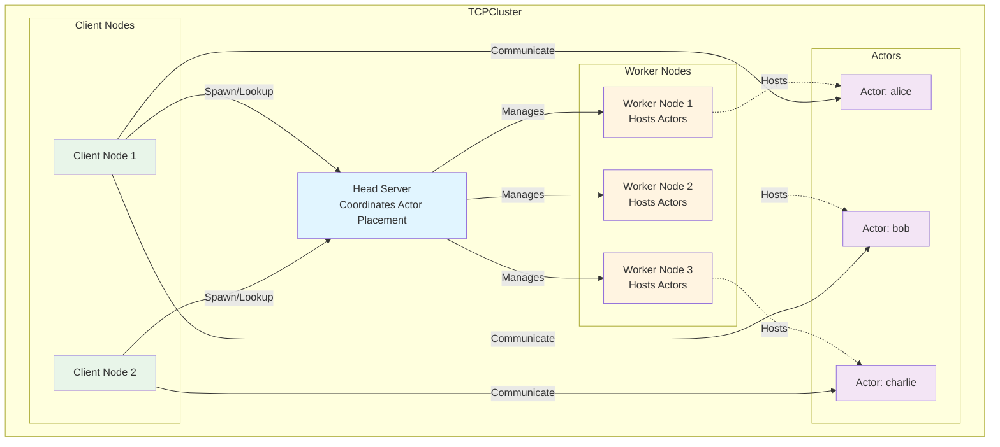

# Actor 模型概述

Actor 模型是一种并发编程模型，旨在简化并发任务的处理。

在这个模型中，*actor* 是具有以下特征的基本并发单元：

- 每个 actor 都有自己独立的执行线程。
- 每个 actor 都有自己的成员变量。
- 这些变量只能由 actor 自己的线程访问和修改。
- Actor 包含一种特殊的成员函数，称为 *receiver*。当调用 receiver 时，调用将被添加到队列中，并在 actor 的线程上按顺序执行。
- 一旦没有引用指向 actor 且所有 receiver 都已执行完毕，actor 就可以被系统回收。

> **注意：**
> Actor 模型的第三个特征尚未被语言强制执行，因此 *actor* 的成员变量尚未提供完整的并发安全性。未来，新的类型系统可能会解决这个问题，确保成员变量的并发安全性。

Actor 模型主要用于多线程环境中对同一对象的并发访问和修改。例如，银行账户对象可能被多个线程同时访问以进行存款或取款等操作，在没有适当同步的情况下可能导致数据竞争。

```cangjie
public class Account {
    public Account(
        private let name: String,
        private var balance: Float64
    ) {}

    public func deposit(amount: Float64): Unit {
        balance += amount
    }

    public func withdraw(amount: Float64): Unit {
        if (balance < amount) {
            throw BalanceNotEnoughException(name)
        }
        balance -= amount
    }

    public func getBalance(): Float64 {
        balance
    }
}
```

在多线程环境中同时访问和修改对象可能导致数据竞争：

```cangjie
let account = Account("Steven", 0.0)
spawn {
    account.deposit(1000.0)
}
spawn {
    account.withdraw(2000.0)
}
```

正确使用 Actor 模型可以使并发编程更简单、更高效。


# 本地 Actor

使用上面的银行账户示例，为了避免线程安全问题，我们可以使用 Actor 模型设计一个专门处理账户操作的 *actor*。

首先，我们可以使用 [@Actor](./api/macros/macros_package_api/macros_package_macros.md#actor-宏) 宏来注解 `Account` 类，将其标记为 actor。然后，我们使用 [@Receiver](./api/macros/macros_package_api/macros_package_macros.md#receiver-宏) 宏来标记 `deposit`、`withdraw` 和 `getBalance` 函数：


```cangjie
@Actor
public class Account {
    public Account(
        private let name: String,
        private var balance: Float64
    ) {}

    @Receiver
    public func deposit(amount: Float64): Unit {
        balance += amount
    }

    @Receiver
    public func withdraw(amount: Float64): Unit {
        if (balance < amount) {
            throw BalanceNotEnoughException(name)
        }
        balance -= amount
    }

    @Receiver
    public func getBalance(): Float64 {
        balance
    }
}
```

关于 [@Actor](./api/macros/macros_package_api/macros_package_macros.md#actor-宏) 和 [@Receiver](./api/macros/macros_package_api/macros_package_macros.md#receiver-宏) 宏的规则和限制，请参考相应的文档。

我们可以通过调用其构造函数来创建 `Account` 类的实例，例如：

```cangjie
let stevenAccount: Account = Account("Steven", 0.0)
```

当创建 `Account` 实例时，系统还会自动为该实例创建关联的执行线程。

## Receiver

与普通函数不同，receiver 的调用是异步的，它返回一个 [ActorFuture\<T>](./api/actors_package_api/actors_package_classes.md#class-actorfuture) 对象。这个对象允许您等待 receiver 的完成并获取结果，其中 `T` 是 receiver 的返回类型。例如，调用 `getBalance` 将返回一个 [ActorFuture\<Float64>](./api/actors_package_api/actors_package_classes.md#class-actorfuture) 对象：

```cangjie
let fut: ActorFuture<Float64> = stevenAccount.getBalance()
```

当调用 receiver 时，调用被添加到队列中，并在 actor 的专用线程上顺序执行。

随后，我们可以通过调用 [ActorFuture\<T>](./api/actors_package_api/actors_package_classes.md#class-actorfuture) 对象的 `get` 函数来阻塞当前的 Cangjie 线程，这将等待直到 `steven.getBalance()` receiver 完成并返回类型为 `T` 的值。

```cangjie
let stevenBalance: Float64 = fut.get()
```

`stevenBalance` 的值将取决于 `steven.getBalance()` 执行时 `balance` 成员变量的值。

在多线程环境中，虽然 receiver 可能被并发调用，但它们在同一 actor 实例内顺序执行，防止任何交错执行。因此，我们可以将它们视为这个 actor 的原子函数，这有助于避免数据竞争。

```cangjie
let account = Account("Steven", 0.0)
spawn {
    account.deposit(1000.0)
}
spawn {
    account.withdraw(2000.0)
}
```

> **注意：**
> 目前，actor 的成员变量尚未提供完整的并发安全性。例如，在以下情况下，公共成员变量仍然可以从外部直接访问和修改：
> ```cangjie
> @Actor
> public class MyActor {
>     public var x: Int64 = 0
> }
>
> let myActor = MyActor()
> spawn {
>     myActor.x = 2
> }
> spawn {
>     myActor.x = 3
> }
> ```
>
> 未来，新的类型系统可能会解决这个问题，确保成员变量的并发安全性。

## Receiver 的执行顺序

当在同一线程内对同一 actor 调用两个 receiver 时，这些函数将按照它们被调用的顺序执行。例如：

```cangjie
func foo() {
    let account = Account("Federico", 0.0)
    account.deposit(1000.0)
    account.withdraw(500.0)
    let fut = account.getBalance()
    println(fut.get())
}
```

在没有其他线程的情况下，此代码将始终输出以下内容，确保 `account.withdraw(500.0)` 不会在 `account.deposit(1000.0)` 之前执行：

```text
500.0
```

但是，当不同线程调用同一 actor 的 receiver 时，执行顺序不能保证。例如：

```cangjie
let account = Account("Steven", 0.0)
spawn {
    account.deposit(1000.0)
}
spawn {
    account.withdraw(500.0)
}
```

以下执行顺序是可能的：

```text
account.deposit(1000.0)
account.withdraw(500.0)
```

```text
account.withdraw(500.0)
account.deposit(1000.0)
```

## Receiver 抛出的异常

Receiver 抛出的任何未捕获的异常或错误都会传播到相应的 [ActorFuture\<T>](./api/actors_package_api/actors_package_classes.md#class-actorfuture) 对象，类似于 `spawn` 处理它们的方式。

继续使用 `Account` 示例，如果 `withdraw(amount)` 函数中的 `balance` 不足，它将抛出 `BalanceNotEnoughException`：

```cangjie
@Receiver
public func withdraw(amount: Float64): Unit {
    if (balance < amount) {
        throw BalanceNotEnoughException(name)
    }
    balance -= amount
}
```

抛出的异常将被传递给相应的 [ActorFuture](./api/actors_package_api/actors_package_classes.md#class-actorfuture) 对象，当调用其 `get` 函数时，将抛出相同的异常。即在以下示例中：

```cangjie
let account = Account("Hamid", 0.0)
let fut: ActorFuture<Unit> = account.withdraw(500.0)
try {
    let res = fut.get() // throws BalanceNotEnoughException
} catch (e: BalanceNotEnoughException) {
    println("fut.get() throws BalanceNotEnoughException")
    println()
    e.printStackTrace()
}
```

由于 `account.withdraw(500.0)` 抛出了 `BalanceNotEnoughException`，调用 `fut.get()` 也会抛出相同的异常。输出将如下：

```text
fut.get() throws BalanceNotEnoughException

An exception has occurred:
Exception: Balance for account Hamid is not enough.
         at default.BalanceNotEnoughException::init(std.core::String)(/home/.../main.cj:6)
         at default.Account::withdraw::lambda.0()(/home/.../main.cj:25)
         at actors.ActorFuture<...>::execute()(stdx/actors/actor_future.cj:90)
         at actors.SequentialDispatcher::startActorLoop::lambda.0()(stdx/actors/actors.cj:46)
```

当 receiver 抛出异常时，actor 的专用线程将继续执行队列中的下一个 receiver 调用：

```cangjie
let account = Account("Hamid", 0.0)

let fut: ActorFuture<Unit> = account.withdraw(500.0)
let fut2: ActorFuture<Float64> = account.getBalance()

try {
    let res = fut.get()
} catch (e: BalanceNotEnoughException) {
    println("fut.get() throws BalanceNotEnoughException")
    println()
    e.printStackTrace()
    println()
}

let res = fut2.get() // account.getBalance() 仍将被执行
println("Balance = ${res}")
```

在 actor 的线程内执行 `account.withdraw(500.0)` 并抛出异常后，线程将继续执行 `account.getBalance()`。输出将如下：

```text
fut.get() throws BalanceNotEnoughException

An exception has occurred:
Exception: Balance for account Hamid is not enough.
         at default.BalanceNotEnoughException::init(std.core::String)(/home/.../main.cj:6)
         at default.Account::withdraw::lambda.0()(/home/.../main.cj:25)
         at actors.ActorFuture<...>::execute()(stdx/actors/actor_future.cj:90)
         at actors.SequentialDispatcher::startActorLoop::lambda.0()(stdx/actors/actors.cj:46)

Balance = 0.0
```

稍后我们将添加一个功能，允许开发者控制处理异常和错误的行为，例如停止或重启 actor。

## Actor 的生命周期

当没有引用指向 actor 且没有待执行的 receiver 调用时，actor 可以被垃圾回收：

```cangjie
func test(): Unit {
    let account = Account("Ziming", 0.0)
    let fut = account.deposit(5.0)
    println(fut.get())
}

func bar() {
    test()
    // account 可能被回收
}
```

在 `test()` 函数返回后，由于没有剩余的 account 引用且没有待执行的 receiver（因为我们在 `test()` 内等待了 `account.deposit(5.0)` 的结果），account 引用的 actor 及其专用执行线程将被系统回收。


## Receiver 之间的优先级

用户可以为 receiver 指定优先级，允许高优先级的 receiver 在低优先级的 receiver 之前执行。

首先，用户需要通过向类添加 `[enableReceiverPriority: true]` 注解来启用 receiver 优先级。例如：

```cangjie
@Actor[enableReceiverPriority: true]
public class Account {
    public Account(
        private let name: String,
        private var balance: Float64
    ) {}
}
```

如果 `enableReceiverPriority` 设置为 `false` 或者 `@Actor` 宏不包含此选项，则意味着未启用 receiver 优先级。

接下来，我们可以为每个 receiver 分配默认优先级级别。目前，我们提供 10 个优先级级别，用 1 到 10 的整数表示。数字越高，优先级越高。如果未设置优先级选项，默认值为 5：

```cangjie
@Actor[enableReceiverPriority: true]
public class Account {
    ...

    @Receiver[priority: 10]
    public func deposit(amount: Float64): Unit {
        balance += amount
    }

    @Receiver[priority: 1]
    public func withdraw(amount: Float64): Unit {
        if (balance < amount) {
            throw BalanceNotEnoughException(name)
        }
        balance -= amount
    }

    @Receiver
    public func getBalance(): Float64 {
        balance
    }
}
```

通过提高 `deposit` 的优先级并降低 `withdraw` 的优先级，当同时有许多 `deposit` 和 `withdraw` 调用时，`deposit` 将被优先处理，减少 `withdraw` 抛出 `BalanceNotEnoughException` 的机会。

此外，在调用 receiver 时，可以通过在参数列表末尾传递额外的命名参数 *priority* 来覆盖其优先级：

```cangjie
func foo(account: Account) {
    account.getBalance()
    account.withdraw(100.0, priority: 10)
}
```

对 `account.withdraw(100.0, priority: 10)` 的调用可能在 `account.getBalance()` 之前执行。

## 死锁

最后，请注意在 actor 的 receiver 内调用 `fut.get()` 可能导致死锁。例如：

```cangjie
@Actor
class MyActor {
    @Receiver
    func foo(): Int64 {
        let fut = this.bar()
        // 这将死锁
        fut.get()
    }

    @Receiver
    func bar(): Int64 {
        42
    }
}
```

调用 `this.bar()` 会将 receiver 添加到队列末尾。但是，在 receiver 内阻塞会导致 actor 的线程阻塞，因此 `bar()` 永远不会被执行。因此，在 `foo()` 内调用 `fut.get()` 将无限期阻塞。

## 在 Tell 模式下调用 Receiver

如前所述，receiver 返回一个 [ActorFuture](./api/actors_package_api/actors_package_classes.md#class-actorfuture)，允许调用者等待 receiver 调用返回并获取返回值。我们说这些调用处于"Ask"模式，因为调用者期望 actor 以完成的 [ActorFuture](./api/actors_package_api/actors_package_classes.md#class-actorfuture) 形式回复。

但是，在某些场景中，调用者可能不需要与 actor 同步，也不需要 receiver 的结果。在这种情况下，可能希望避免创建 [ActorFuture](./api/actors_package_api/actors_package_classes.md#class-actorfuture) 带来的开销，并在"Tell"模式下调用 receiver。在"Tell"模式下调用 receiver 不会创建任何 [ActorFuture](./api/actors_package_api/actors_package_classes.md#class-actorfuture)，返回 `Unit`，并需要一个名为 `tell` 的额外参数，该参数只接受值 `Tell.True`：

```cangjie
func foo(account: Account) {
    let _: Unit = account.withdraw(100.0, priority: 10, tell: True)
}
```

用户还可以通过向 `@Receiver` 宏提供 `mode` 选项来限制调用 receiver 的方式：

```cangjie
@Actor
public class Account {
    ...

    @Receiver[mode: TellOnly]
    public func deposit(amount: Float64): Unit {
        balance += amount
    }

    @Receiver[mode: AskAndTell]
    public func withdraw(amount: Float64): Unit {
        if (balance < amount) {
            throw BalanceNotEnoughException(name)
        }
        balance -= amount
    }

    @Receiver[mode: AskOnly]
    public func getBalance(): Float64 {
        balance
    }
}
```

在上面的示例中，

- 函数 `getBalance` 只能在"Ask"模式下调用。
- 函数 `deposit(Float64)` 只能在"Tell"模式下调用。
- 函数 `withdraw(Float64)` 可以在"Ask"和"Tell"模式下调用。

请注意，适用于"Ask"模式下 receiver 调用的顺序保证也适用于"Tell"模式下的 receiver 调用。

## 完整示例

<!-- compile -->

```cangjie
import std.collection.ArrayList

import actors.*
import actors.macros.*

@Actor[enableReceiverPriority: true]
public class Account {
    public Account(
        private let name: String,
        private var balance: Float64
    ) {}

    @Receiver[priority: 10]
    public func deposit(amount: Float64): Unit {
        balance += amount
    }

    @Receiver[priority: 1]
    public func withdraw(amount: Float64): Unit {
        if (balance < amount) {
            throw BalanceNotEnoughException(name)
        }
        balance -= amount
    }

    @Receiver
    public func getBalance(): Float64 {
        balance
    }
}

public class BalanceNotEnoughException <: Exception {
    public init(name: String) {
        super("Balance for account ${name} is not enough.")
    }
}

main() {
    let account = Account("Steven", 0.0)
    let futs = ArrayList<Future<Unit>>()
    for (_ in 0..100) {
        let fut1 = spawn {
            for (_ in 0..10) {
                account.deposit(1000.0)
            }
        }
        let fut2 = spawn {
            for (_ in 0..10) {
                account.withdraw(1000.0)
            }
        }
        futs.append(fut1)
        futs.append(fut2)
    }
    for (f in futs) {
        f.get()
    }
    println("Balance: ${account.getBalance().get()}")
}
```


# 分布式 Actor

Actor 模型可以扩展到在分布式系统的多个节点（进程、机器等）上工作。在 Cangjie 中，分布式 actor 允许您创建即使在网络中的不同节点上运行时也能相互通信的 actor。

## Actor 接口

要创建分布式 actor，您首先需要使用 [@ActorInterface](./api/macros/macros_package_api/macros_package_macros.md#actorinterface-macro) 宏定义 *actor 接口*。此接口定义了分布式 actor 必须实现的契约。

```cangjie
@ActorInterface[distributed: true]
public interface BankAccount {
    @Receiver
    func deposit(amount: Float64): Bool

    @Receiver
    func withdraw(amount: Float64): Bool

    @Receiver
    func getBalance(): Float64
}
```

`distributed: true` 选项表示这是一个分布式 actor 接口，这意味着它可以用于跨网络的远程通信。

## 实现分布式 Actor

一旦您有了 actor 接口，您可以使用 [@Actor](./api/macros/macros_package_api/macros_package_macros.md#actor-宏) 宏来实现它：

```cangjie
@Actor
public class BankAccountImpl <: BankAccount {
    private let name: String
    private var balance: Float64

    public init(name: String, balance: Float64) {
        this.name = name
        this.balance = balance
    }

    @Receiver
    public func deposit(amount: Float64): Bool {
        balance += amount
        true
    }

    @Receiver
    public func withdraw(amount: Float64): Bool {
        if (balance < amount) {
            return false
        }
        balance -= amount
        true
    }

    @Receiver
    public func getBalance(): Float64 {
        balance
    }
}
```

## ActorHost

要管理分布式 actor，您需要一个 actor host 和 client。Actor host 可用于导出 actor，用户可以通过 actor client 获取代理：

```cangjie
// 创建 actor host（实现取决于您的分布式设置）
let actorHost: ActorHost

// 创建并导出 actor
let bankAccount = BankAccountImpl("alice", 1000.0)
match (actorHost.export("alice", bankAccount)) {
    case Some(proxy) =>
        println("Bank account exported successfully")
        // 如果需要，可以直接使用代理
    case None =>
        println("Failed to export bank account: name already taken")
        return
}
```

`export` 函数使用 *name* 导出分布式 actor。此名称在该特定 actor host 的导出 actor 中应该是唯一的。使用相同名称导出两次将返回 `None`。成功导出时，它返回 `Some(ActorProxy)`，可直接用于本地通信。

一旦 actor 被导出，相应的 actor client 就可以找到它。

## Actor Client 和远程 Actor 通信

```cangjie
// 创建用于远程通信的 actor client
let actorClient: ActorClient
```

要获取已导出分布式 actor 的代理，您可以使用 actor client 的 `getActor()` 方法：

```cangjie
// 创建代理以与远程 actor 通信
match (actorClient.getActor("alice")) {
    case Some(bankProxy) =>
        // 使用代理
    case None =>
        println("Actor not found")
}
```

如果找不到 actor，`getActor()` 方法将返回 `None`，如果与客户端的连接失败，将抛出 `RemoteException`。

或者，您可以直接使用 actor 名称和 host info 创建 `ActorProxy`：

```cangjie
// 创建代理以与远程 actor 通信
let bankProxy = ActorProxy("alice", actorClient.getHostInfo())
```

但这不会检查 actor 是否存在。

一旦我们获得 actor 代理，我们可以使用 `ask` 或 `tell` 函数对特定 receiver 进行远程调用：

```cangjie
// 调用远程方法 - 这些返回 DistributedFuture 对象
let depositFut: DistributedFuture = bankProxy.ask("deposit", [
    500.0.serialize()
])
```

`ask` 函数具有以下签名：

```cangjie
public func ask(receiverName: String, args: Array<DataModel>, config!: ReceiverConfig = ReceiverConfig.default): DistributedFuture
```

如果 actor 之前已从 host 取消导出（使用 `unexport` 函数），此函数将抛出 `ActorNotFoundException`。

`receiverName` 对应于在 actor 接口中声明的 receiver 名称。请注意，这意味着 actor 接口声明中不允许函数重载，如果违反，将抛出宏错误。如果找不到匹配的 receiver，此函数将抛出 `ReceiverNotFoundException`。

`args` 是 `DataModel` 数组，这是该特定 receiver 的序列化参数。如果提供的参数无效，例如数量不匹配或类型不匹配，此函数将抛出 `IllegalArgumentException`。

当远程连接失败时，此函数还会抛出 `RemoteException`，对于来自特定 actor 系统的任何潜在错误，会抛出 `ActorSystemException`。

`tell` 函数类似，只是它不返回 `DistributedFuture`。

远程 receiver 的执行顺序与本地 receiver 相同，从同一线程在同一 actor 上调用两个（远程）receiver 时，这些 receiver 将按调用顺序执行。

```cangjie
depositFut.get()
```

如果 receiver 的执行抛出任何异常或错误，此函数将抛出 `RemoteReceiverException`，它包装了原始异常（或错误）的消息和堆栈跟踪。

当连接失败时，此函数还会抛出 `RemoteException`，对于任何 actor 系统特定错误，会抛出 `ActorSystemException`。

## 类型化代理（Typed-proxy）

为了更方便地使用 actor 代理，用户可以从 actor 接口获取类型化代理，并使用普通的 receiver 调用语法调用其远程 receiver。例如：

```cangjie
// 首先获取 ActorProxy
let actorProxy = match (actorClient.getActor("alice")) {
    case Some(proxy) => proxy
    case None => throw Exception("Actor not found")
}

// 创建类型化代理以与远程 actor 通信
let bankProxy: BankAccount = BankAccount.getProxy(actorProxy)
```

获取类型化代理后，我们可以像调用本地 actor 一样调用其远程 receiver：

```cangjie
// 调用远程方法 - 这些返回 ActorFuture 对象
let depositFut: ActorFuture<Bool> = bankProxy.deposit(500.0)
let balanceFut: ActorFuture<Float64> = bankProxy.getBalance()
```

使用类型化代理调用远程 receiver 本质上会调用底层 `ActorProxy` 的 `ask` 或 `tell` 函数，当连接失败时会抛出 `RemoteException`，对于任何 actor 系统特定错误会抛出 `ActorSystemException`。

此函数返回一个 `ActorFuture<T>`，可用于获取远程 receiver 调用的结果。

```cangjie
depositFut.get()
let balance = balanceFut.get()
println("Alice's balance: ${balance}") // 输出: 1500.0
```

## 传递代理作为参数

由于类型化代理（如 `BankAccount`）是可序列化的，它们可以作为参数传递给 receiver 函数。这使 actor 能够通过传递引用来相互通信，这对于构建需要协调的复杂分布式系统非常有用。

例如，您可以定义一个接受类型化代理作为参数的 receiver：

```cangjie
@ActorInterface[distributed: true]
public interface BankAccount {
    @Receiver
    func deposit(amount: Float64): Bool

    @Receiver
    func withdraw(amount: Float64): Bool

    @Receiver
    func getBalance(): Float64

    @Receiver
    func transfer(to: BankAccount, amount: Float64): Bool
}
```

`transfer` 方法接受一个 `BankAccount` 类型化代理作为参数。实现此 receiver 时：

```cangjie
@Receiver
public func transfer(to: BankAccount, amount: Float64): Bool {
    if (amount > balance) {
        return false
    }
    balance -= amount
    to.deposit(amount).get()
    true
}
```

调用这样的 receiver 时，您可以直接传递类型化代理：

```cangjie
// 在 host 端，导出多个 actor
let tcpHost = TCPActorHost(addr: "localhost", bindAt: 8080)
let stevenAccount = BankAccountImpl("Steven", 100.0)
let federicoAccount = BankAccountImpl("Federico", 0.0)
tcpHost.export("Steven", stevenAccount)
tcpHost.export("Federico", federicoAccount)
tcpHost.serve()

// 在 client 端，获取类型化代理并将它们作为参数传递
let tcpClient = TCPActorClient.create("localhost", 8080)
let steven = BankAccount.getProxy(tcpClient.getActor("Steven").getOrThrow())
let federico = BankAccount.getProxy(tcpClient.getActor("Federico").getOrThrow())

// 通过将 federico 作为参数传递，从 Steven 转账到 Federico
steven.transfer(federico, 50.0).get()

println("Steven balance: ${steven.getBalance().get()}") // 50.0
println("Federico balance: ${federico.getBalance().get()}") // 50.0
```

类型化代理在作为参数传递时会自动序列化，并在接收端反序列化，使远程 actor 能够获取代理以与原始 actor 通信。这使 actor 能够建立双向通信通道并构建复杂的分布式协调模式。


## 与本地 Actor 的主要区别

1. **序列化**：receiver 的所有参数和返回值都必须可序列化
2. **网络通信**：调用通过网络进行，因此可能具有更高的延迟，并且容易受到分布式系统故障的影响


# 使用 TCPActorSystem

TCPActorSystem 提供了使用 TCP 套接字进行网络通信的分布式 actor 系统的生产就绪实现。本节展示如何设置和使用基于 TCP 的分布式 actor 系统。

## 设置 TCP Actor Host

要创建可以接受远程客户端连接的 TCP actor host：

```cangjie
import actors.tcp_actor_system.*

// 创建在 localhost:8080 上监听的 TCP actor host
let tcpHost = TCPActorHost(addr: "localhost", bindAt: 8080)

// 向 host 导出 actor
let bankService = BankServiceImpl()
match (tcpHost.export("bank-service", bankService)) {
    case Some(_) => println("Bank service exported")
    case None => println("Failed to export: name already taken")
}

// 启动服务器以接受客户端连接
let serverFuture = tcpHost.serve()

println("TCP Actor Host is running on port 8080")
```

## 设置 TCP Actor Client

要创建连接到远程 TCP actor host 的 TCP actor client：

```cangjie
import actors.tcp_actor_system.*

// 创建连接到 localhost:8080 的 TCP actor client
let tcpClient = TCPActorClient.create("localhost", 8080)

// 获取用于远程通信的代理
let bankProxy = match (tcpClient.getActor("bank-service")) {
    case Some(proxy) => proxy
    case None => throw Exception("Actor not found")
}

// 使用代理进行远程调用
let createFut: DistributedFuture = bankProxy.ask("createAccount", [
    "alice".serialize(),
    1000.0.serialize()
])

// 等待操作完成
createFut.get()
println("Account created successfully")
```

## 完整的 TCP Actor 系统示例

这是一个显示主机和客户端两端的完整示例：

### 主机端（服务器）

```cangjie
import std.collection.*

import actors.*
import actors.macros.*
import actors.distributed.*
import actors.tcp_actor_system.*

import encoding.json.*
import serialization.serialization.*

@ActorInterface[distributed: true, description: "Bank service"]
public interface BankService {
    @Receiver[description: "Transfer money between accounts"]
    func transfer(from: String, to: String, amount: Float64): Bool
}

@Actor
public class BankServiceImpl <: BankService {
    @Receiver
    public func transfer(from: String, to: String, amount: Float64): Bool {
        // 转账逻辑
        println("Transferred ${amount} from ${from} to ${to}")
        true
    }
}

const PORT: UInt16 = 52165

main() {
    // 创建并启动 TCP actor host
    let tcpHost = TCPActorHost(addr: "localhost", bindAt: PORT)
    let serverFuture = tcpHost.serve()

    // 导出银行服务
    let bankService = BankServiceImpl()
    match (tcpHost.export("bank-service", bankService)) {
        case Some(_) => println("Bank service exported")
        case None => println("Failed to export: name already taken")
    }

    println("TCP Actor Host is running on port ${PORT}")
    println("Press Ctrl+C to stop the server")

    // 保持服务器运行
    serverFuture.get()
}
```

### 客户端

```cangjie
import std.collection.*
import actors.*
import actors.distributed.*
import actors.tcp_actor_system.*
import encoding.json.*
import serialization.serialization.*

const PORT: UInt16 = 52165

main() {
    let tcpClient = TCPActorClient.create("localhost", PORT)

    try {
        let bankProxy = match (tcpClient.getActor("bank-service")) {
            case Some(proxy) => proxy
            case None => throw Exception("Actor not found")
        }

        let transferFut: DistributedFuture = bankProxy.ask("transfer", [
            "alice".serialize(),
            "bob".serialize(),
            100.0.serialize()
        ])

        transferFut.get()
        println("Transfer completed")

    } catch (e: Exception) {
        println("Unexpected error: ${e.message}")
    } finally {
        // 关闭客户端连接
        tcpClient.close()
    }
}
```

## 日志配置

TCP actor 系统提供可配置的日志记录：

```cangjie
import std.log.*

// 为 TCP actor 系统配置日志记录
TCPActorSystem.logger = SimpleLogger()

// 或使用自定义日志记录器
let customLogger = CustomLogger()
TCPActorSystem.logger = customLogger
```

# 使用 TCPCluster

TCPCluster 提供了一个基于集群的分布式 actor 系统，允许您在多个工作节点上生成、管理和与分布式 actor 通信。集群由一个协调 actor 放置的头服务器和多个托管实际 actor 的工作节点组成。

## 集群架构

TCPCluster 由以下部分组成：

- **头服务器（Head Server）**：一个中央协调器，管理整个集群中的 actor 注册、放置和查找
- **工作节点（Worker Nodes）**：多个托管和执行分布式 actor 的节点
- **客户端节点（Client Nodes）**：可选节点，可以加入集群以生成和与 actor 交互，但不托管它们

以下图表说明了集群架构：



## 创建可生成的 Actor

要在 TCPCluster 中使用 actor，它们必须实现 `Spawnable<T>` 接口。此接口需要：

1. 一个 `typeName()` 静态函数，返回唯一的类型标识符
2. 一个 `spawnWith(args: Array<SpawnArgument>)` 静态函数，从参数创建 actor 实例
3. 在集群中注册可生成类型及其参数类型

以下是一个可生成 actor 接口的示例：

```cangjie
@ActorInterface[distributed: true]
public interface BankAccount <: Spawnable<BankAccount> {
    @Receiver
    func deposit(amount: Float64): Bool

    static func typeName(): String {
        "BankAccount"
    }

    static func spawnWith(args: Array<SpawnArgument>): Option<BankAccount> {
        if (args.size == 0) {
            return Some(BankAccountImpl())
        }
        if (args.size == 1) {
            return Some(BankAccountImpl((args[0].value as String).getOrThrow()))
        }
        if (args.size == 2) {
            return Some(BankAccountImpl(
                (args[0].value as String).getOrThrow(),
                (args[1].value as Float64).getOrThrow()
            ))
        }
        None
    }
}
```

正确实现 `spawnWith` 函数以构造 actor 实例非常重要。以下是实现 `BankAccount` 接口的 actor 示例：

```cangjie
@Actor
public class BankAccountImpl <: BankAccount {
    private let name: String
    private var balance: Float64

    public init(name: String, initialBalance: Float64) {
        this.name = name
        this.balance = initialBalance
    }

    public init(name: String) {
        this.name = name
        this.balance = 0.0
    }

    public init() {
        this.name = "Unknown"
        this.balance = 0.0
    }

    @Receiver
    public func deposit(amount: Float64): Bool {
        balance += amount
        true
    }
}
```

请注意，此 actor 类中的三个构造函数对应于 `spawnWith` 函数中的三种情况。用户还需要使用以下方式注册生成函数：

```cangjie
// 注册可生成类型
ActorCluster.registerSpawnable<BankAccount>(BankAccount.typeName(), BankAccount.spawnWith)
```

并注册传递给构造函数的参数：

```cangjie
// 注册可在 SpawnArgument 中使用的参数类型
ActorCluster.registerSpawnArgument<String>("String")
ActorCluster.registerSpawnArgument<Float64>("Float64")
```

这些注册必须在使用分布式 actor 之前完成，并且**必须**在所有工作节点上执行。

## 设置头服务器

头服务器协调集群。使用 `createHeadServer` 函数创建并启动它：

```cangjie
TCPCluster.createHeadServer(headServerAddr: headServerAddr, headServerPort: headServerPort)
```

调用此函数将启动服务器并返回其线程句柄。

## 设置工作节点

工作节点托管实际的 actor。每个工作节点需要使用以下方式连接到头服务器：

```cangjie
TCPCluster.createWorker(
    headServerAddr: headServerAddr,
    headServerPort: headServerPort,
    workerId: workerId,
    workerAddr: workerAddr,
    workerPort: workerPort
)
```

每个工作节点必须具有唯一的 `workerId`。调用此函数将启动工作线程并返回其线程句柄。

## 作为客户端加入

您也可以作为仅客户端节点加入集群，该节点可以生成和与 actor 交互，但不会托管它们：

```cangjie
TCPCluster.join(headServerAddr: headServerAddr, headServerPort: headServerPort)
```

这将返回一个布尔值，指示是否成功加入集群。

## 在集群中生成和使用 Actor

一旦集群设置完成，您就可以生成 actor 并与它们交互。可以从已加入集群的任何节点（作为工作节点或客户端）生成 actor：

```cangjie
// 使用不同的构造函数参数生成 actor
let aliceOpt: Option<BankAccount> = TCPCluster.spawnActor<BankAccount>(
    "alice",
    [
        SpawnArgument.create<String>("String", "alice"),
        SpawnArgument.create<Float64>("Float64", 100.0)
    ]
)
let alice = aliceOpt.getOrThrow()
```

然后，您可以像使用本地 actor 引用一样使用类型化代理：

```cangjie
alice.deposit(100.0)
```

## 查找现有 Actor

您可以查找在集群中其他地方生成的 actor：

```cangjie
// 按名称查找现有 actor
let account = TCPCluster.getActor<BankAccount>("alice")
match (account) {
    case Some(proxy) => {
        let balance = proxy.getBalance().get()
        println("Alice's balance: ${balance}")
    }
    case None => println("Actor 'alice' not found")
}
```

## 完整的集群示例

以下是一个显示完整集群设置的完整示例：

### 通用 Actor 定义（所有节点共享）

```cangjie
package cluster_example.common

import std.collection.*

import actors.*
import actors.macros.*
import actors.distributed.*
import actors.tcp_actor_system.*
import actors.tcp_actor_system.cluster.*

import encoding.json.*
import serialization.serialization.*

@ActorInterface[distributed: true]
public interface BankAccount <: Spawnable<BankAccount> {

    @Receiver
    func deposit(amount: Float64): Bool

    @Receiver
    func withdraw(amount: Float64): Bool

    @Receiver
    func getBalance(): Float64

    static func typeName(): String {
        "BankAccount"
    }

    static func spawnWith(args: Array<SpawnArgument>): Option<BankAccount> {
        if (args.size == 0) {
            return Some(BankAccountImpl())
        }
        if (args.size == 1) {
            return Some(BankAccountImpl((args[0].value as String).getOrThrow()))
        }
        if (args.size == 2) {
            return Some(BankAccountImpl((args[0].value as String).getOrThrow(), (args[1].value as Float64).getOrThrow()))
        }
        None
    }
}

@Actor
public class BankAccountImpl <: BankAccount {
    private let name: String
    private var balance: Float64

    static init() {
        ActorCluster.registerSpawnable<BankAccount>(BankAccount.typeName(), BankAccount.spawnWith)
        ActorCluster.registerSpawnArgument<String>("String")
        ActorCluster.registerSpawnArgument<Float64>("Float64")
    }

    public init(name: String, initialBalance: Float64) {
        this.name = name
        this.balance = initialBalance
    }

    public init(name: String) {
        this.name = name
        this.balance = 0.0
    }

    public init() {
        this.name = "Unknown"
        this.balance = 0.0
    }

    @Receiver
    public func deposit(amount: Float64): Bool {
        balance += amount
        true
    }

    @Receiver
    public func withdraw(amount: Float64): Bool {
        if (balance < amount) {
            return false
        }
        balance -= amount
        true
    }

    @Receiver
    public func getBalance(): Float64 {
        balance
    }
}

public func entry() {
    let alice = TCPCluster.spawnActor<BankAccount>("alice", [SpawnArgument.create<String>("String", "alice"), SpawnArgument.create<Float64>("Float64", 100.0)]).getOrThrow()
    let bob = TCPCluster.spawnActor<BankAccount>("bob", [SpawnArgument.create<String>("String", "bob")]).getOrThrow()
    alice.deposit(100.0).get()
    bob.withdraw(50.0).get()
    println("Alice's balance: ${alice.getBalance().get()}")
    println("Bob's balance: ${bob.getBalance().get()}")

    TCPCluster.removeActor("alice")
    TCPCluster.removeActor("bob")

    return 0
}
```

### 头服务器

```cangjie
package cluster_example.head_server

import std.convert.*
import std.log.*

import actors.distributed.*
import actors.tcp_actor_system.*
import actors.tcp_actor_system.cluster.*

import encoding.json.*
import serialization.serialization.*

import cluster_example.common.*

main(args: Array<String>) {
    TCPActorSystem.logger.level = LogLevel.DEBUG

    let port = UInt16.parse(args[0])
    TCPCluster.createHeadServer(headServerAddr: "localhost", headServerPort: port).get()
}
```

### 工作节点

```cangjie
package cluster_example.worker

import std.convert.*
import std.log.*

import actors.distributed.*
import actors.tcp_actor_system.*
import actors.tcp_actor_system.cluster.*

import encoding.json.*
import serialization.serialization.*

import cluster_example.common.*

main(args: Array<String>) {
    TCPActorSystem.logger.level = LogLevel.DEBUG

    let headServerAddr = args[0]
    let headServerPort = UInt16.parse(args[1])
    let workerId = args[2]
    let workerAddr = args[3]
    let workerPort = UInt16.parse(args[4])

    TCPCluster.createWorker(headServerAddr: headServerAddr, headServerPort: headServerPort, workerId: workerId, workerAddr: workerAddr, workerPort: workerPort).get()
}
```

### 入口点

```cangjie
package cluster_example.entry

import std.convert.*
import std.log.*

import actors.*
import actors.distributed.*
import actors.tcp_actor_system.*
import actors.tcp_actor_system.cluster.*

import encoding.json.*
import serialization.serialization.*

import cluster_example.common.*

main(args: Array<String>) {
    TCPActorSystem.logger.level = LogLevel.DEBUG

    let headServerAddr = args[0]
    let headServerPort = UInt16.parse(args[1])
    let workerId = args[2]
    let workerAddr = args[3]
    let workerPort = UInt16.parse(args[4])
    TCPCluster.createWorker(headServerAddr: headServerAddr, headServerPort: headServerPort, workerId: workerId, workerAddr: workerAddr, workerPort: workerPort)

    entry()
}
```

# 使用 MCP 扩展和 CangjieMagic

MCP（模型上下文协议）扩展与 CangjieMagic 结合，提供了一种强大的方式来创建可以与分布式 actor 系统交互的 AI 驱动应用程序。本节展示如何构建可以通过自然语言发现和使用 actor 服务的智能代理。

## 概述

CangjieMagic 是一个框架，使 AI 代理能够与外部工具和服务交互。当与 MCP 扩展结合时，它允许 AI 代理自动发现并调用分布式 actor receiver 函数作为工具，在自然语言处理和分布式 actor 系统之间创建无缝桥梁。

## 设置 CangjieMagic 与 MCP

### 依赖项

首先，将所需的依赖项添加到您的 `cjpm.toml`：

```toml
[dependencies]
  [dependencies.actors]
    git = "git@github.com:Huawei-Edinburgh-Programming-Languages/distributed-actors.git"
  [dependencies.magic]
    git = "https://gitcode.com/Cangjie-TPC/CangjieMagic.git"
    tag = "harmony_os_edition"
```

### 基本代理设置

[ActorToolManager](./api/distributed/mcp/mcp_package_api/mcp_package_classes.md#class-actortoolmanager) 类为开发者提供 API 来添加和删除 [ActorClient](./api/distributed/distributed_package_api/distributed_package_interfaces.md#interface-actorclient)，然后自动添加和删除相应的工具。

为了在代理中使用 [ActorToolManager](./api/distributed/mcp/mcp_package_api/mcp_package_classes.md#class-actortoolmanager)，开发者需要在代理的构造函数内设置 `__TOOL_MANAGER__` 变量：

```cangjie
@agent[model: "deepseek:deepseek-chat"]
class MyAgent {
    @prompt("Your own prompt")

    init(toolManager!: ToolManager) {
        __TOOL_MANAGER__ = Some(toolManager) // 设置自定义工具管理器
    }
}
```

之后，在创建代理时，开发者需要传入一个 [ActorToolManager](./api/distributed/mcp/mcp_package_api/mcp_package_classes.md#class-actortoolmanager) 并添加 actor client：

```cangjie
main() {
    let toolManager = ActorToolManager()
    let agent = MyAgent(toolManager: toolManager)

    let tcpClient = TCPActorClient.create("localhost", 8080)
    toolManager.addActorClient(tcpClient)

    let response = agent.chat("Transfer $100 from Alice to Bob")
    println("Assistant: ${response}")
}
```
