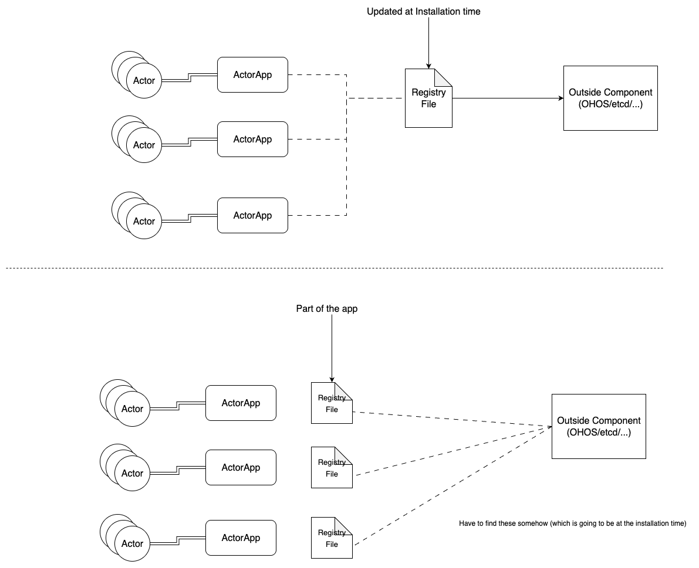
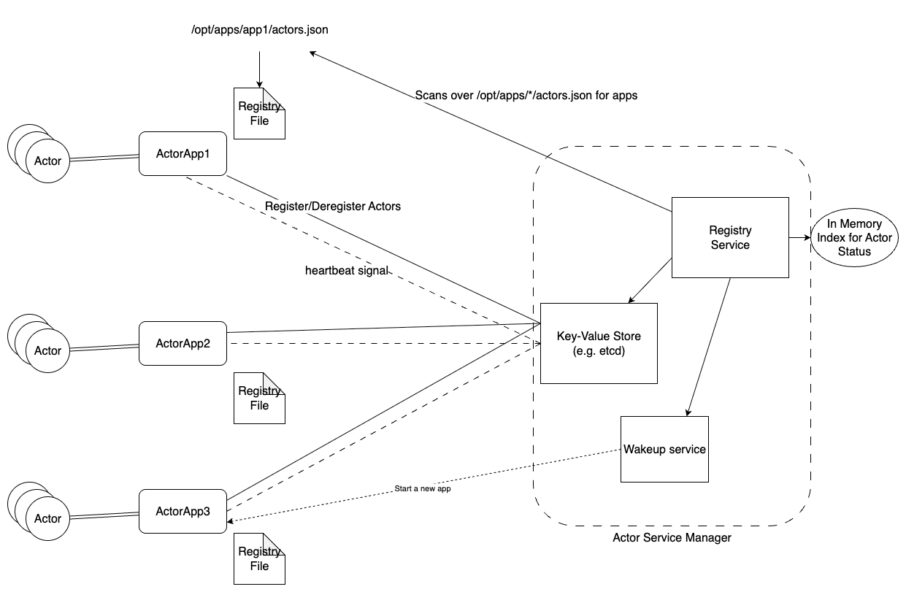
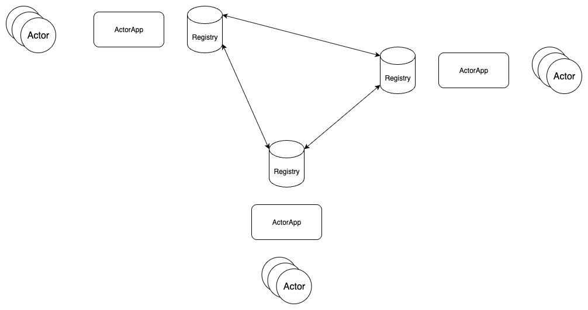
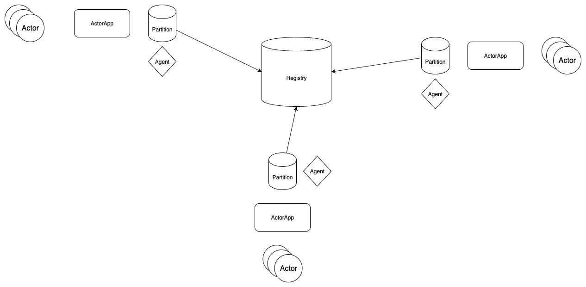

# Registry

This document contains some initial designs for the actor registry.

## Static Registry

The registry is a global state or a config file (yaml, json, etc.) managed by an outside component.

This way services are static and won't change at runtime, but the whole system is dynamic as in we can add/remove services.

Worth noting:

- Dependecy on an outside component. (Beneficial due to existing implementation for the discovery and other features)
- Ability to include custom information in the config file. Not sure about OHOS yet.

### Distributed

Each app has their own static config state(file) configured at installation time, supposedly there is going to be a registry system reading these files and extracting the table entries.

### Centralized

There is a centralized file which apps go and update.



### Example (for distributed solution)

Each app has an static config file and there is a registry indexer running in the background.

```json
# sample config file /opt/apps/app1/actors.json
{
  "app": "CalendarServices",
  "path": "/opt/apps/app1/myapp1",
  "receivers": [
  {
    "name": "someReceiver",
    "args": [
        {
        "type": "type1",
        "name": "arg1",
        "default": "some",
        }
    ],
    "return_type": "type2",
    "desc": "xxx" 
  },
  ...
  ]
}
```

- The registry service will scan `/opt/apps/**/actors.json`
- Builds an in memory index
- Syncs this with a key-value store responsible for keeping records of alive/accessible actors (e.g. *etcd*)
- The state of the app could be `inactive`, `active`, `stale`
- The registry decides the state of the app based on the situation:
    - If an app is present in the config files but not in the key-value store it will be marked as `inactive`
    - If an app is present in the config files and in the key-value store it will be marked as `active`
    - If an `active` app is present in the config files and the not int the key-value store it wil be marked as `stale`

```scss
                                        ┌──────────────────────┐
                                        │ Static Actor Catalog │
                                        │     (e.g. JSON)      │
                                        └────────┬─────────────┘
                                                 │
                                ┌────────────────┴──────────────────────┐
                                │ Actor Registry Service                │
                                │ (Reads static + watches the k/v store)│
                                └────────┬────────────┬─────────────────┘
                                         │            │
         ┌───────────────────────────────┘      ┌─────┴────────────────┐
         │                                      │ Apps (runtime actors)│
┌────────▼────────────────────┐       ┌─────────▼──────────────────┐   │
│ etcd (/actors/*).           │<──────┤ Actors register/deregister │   │
│ Removes actores based on TTL│       └────────────────────────────┘   │
└─────────────────────────────┘         ▲                              │
                                        |  ┌──────────────┐            │
                                        └──┤ start.sh via │◄───────────┘
                                           │ wake_request │
                                           └──────────────┘

```



## Dynamic Registry

Here we assume our registry is a storage(database) to explain the features easier.

### Distributed

In this setup each app is a partition of a distributed database. 

- Data Ownership -> Each app is the owner of it's data (no other can write)

- Access -> Read-only access to remote partitions.

- No Replicas

- Disconnection -> Inaccessible data

- Topology awareness -> Required (Nodes should be aware of the owner of actors)
 
- Each partition shares state with peers in a gossip-like fashion.

- If a node doesn’t hear about another node for too long, it assumes that partition is not available (or the group converges on that info).

- Eventually consistent but scalable and robust.



### Centralized

This setup each app is still a partition of a distributed databse, but the system is controlled by a central dynamic command unit for handling tasks like Partition status keeping, Access policy enforcement, Topology awareness, Metadata handling.

Methods for Partition status keeping:

| Method Name                                     | Latency | Reliability | Load Volume |
|    :---:                                        |  :---:  |    :---:    |    :---:    |
| Heartbeats(App -> Registry)                     |   Low   |     Yes     |     High    |
| Pull(Registry -> App)                           |   Mid   |     Yes     |     Low     |
| Agent Based Monitoring (Seperated control flow) |   Low   |     Yes     |     High    |

